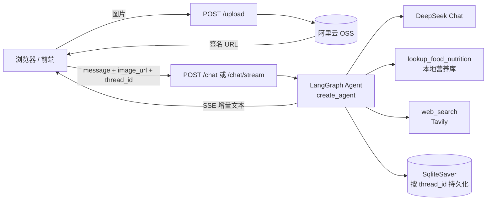

# 私厨营养 Agent

一个基于 **LangGraph + DeepSeek + FastAPI** 的多模态营养分析 Agent：拍一张饭菜照片，结合身高体重等身体数据，自动估算这一餐的热量与营养素，计算"今日剩余热量"，并给出可执行的下一餐建议。

## 项目亮点

- **多模态输入**：图片先上传到阿里云 OSS，再把签名 URL 交给视觉模型，避免把大图塞进对话上下文
- **真实工具调用**：内置 `lookup_food_nutrition` 本地食物营养库工具 + Tavily 联网搜索，热量估算不靠模型瞎猜
- **会话级记忆**：基于 LangGraph `checkpointer` + SQLite，同一个 `thread_id` 自动延续上下文，服务重启后历史不丢
- **流式输出**：`/chat/stream` 用 SSE 逐字返回，前端 `fetch + ReadableStream` 手动解析
- **开箱即用**：自带网页对话界面（FastAPI 静态托管），一条命令即可跑通全流程

## 架构



## 项目结构

```
.
├── app/
│   ├── main.py                 FastAPI 入口：/health /upload /chat /chat/stream + 静态托管
│   ├── config.py               读取 .env、推导 OSS 区域、定位 SQLite 路径
│   ├── oss_client.py           OSS 上传与签名 URL
│   └── agent/
│       └── private_chef.py     Agent 定义：模型、工具、系统提示词、checkpointer
├── web/index.html              单文件对话界面（含 SSE 流式解析）
├── data/
│   └── chinese_food_nutrition.csv   本地食物营养成分表（每 100g）
├── langgraph.json              LangGraph CLI 配置（Studio 调试用）
├── pyproject.toml / uv.lock    uv 依赖管理
└── .env.example                环境变量模板
```

## 技术栈

| 层次 | 选型 |
| --- | --- |
| Agent 编排 | LangGraph `create_agent` + `checkpointer` |
| 模型 | DeepSeek Chat（`langchain-deepseek`） |
| 工具 | `langchain_tavily` 联网搜索、自定义 `@tool` 营养查询 |
| Web 服务 | FastAPI + Uvicorn |
| 会话持久化 | `AsyncSqliteSaver`（aiosqlite） |
| 对象存储 | 阿里云 OSS v2 SDK |
| 前端 | 原生 HTML/CSS/JS + SSE |

## 快速开始

### 1. 环境要求

- Python 3.13+
- [uv](https://docs.astral.sh/uv/)

### 2. 安装依赖

```bash
uv sync
```

### 3. 配置环境变量

```bash
cp .env.example .env
```

然后填写 `.env`（说明见下表）。

### 4. 启动服务

```bash
uv run uvicorn app.main:app --reload --port 8000
```

打开 <http://127.0.0.1:8000> 即可使用网页界面；接口文档在 <http://127.0.0.1:8000/docs>。

### 5.（可选）在 LangGraph Studio 里调试

```bash
uv run langgraph dev
```

Graph 名称为 `chef_agent`，定义在 `app/agent/private_chef.py`。

## 环境变量

| 变量 | 必填 | 说明 |
| --- | --- | --- |
| `DEEPSEEK_API_KEY` | 是 | DeepSeek 模型 API Key |
| `TAVILY_API_KEY` | 是 | Tavily 搜索 API Key |
| `OSS_ACCESS_KEY_ID` | 是 | 阿里云 RAM AccessKey ID |
| `OSS_ACCESS_KEY_SECRET` | 是 | 阿里云 RAM AccessKey Secret |
| `OSS_BUCKET` | 是 | Bucket 名称 |
| `OSS_ENDPOINT` | 是 | 例如 `oss-cn-beijing.aliyuncs.com` |
| `OSS_REGION` | 否 | 不填则从 endpoint 自动推导 |

> `.env` 已在 `.gitignore` 中，不会被提交。

## API

| 方法 | 路径 | 说明 |
| --- | --- | --- |
| `GET` | `/health` | 健康检查 |
| `POST` | `/upload` | 上传图片，返回 OSS URL（限制 5MB） |
| `POST` | `/chat` | 一次性返回完整回答 |
| `POST` | `/chat/stream` | SSE 流式返回 |

请求体（`/chat` 与 `/chat/stream` 相同）：

```json
{
  "message": "帮我看看这顿饭多少热量",
  "thread_id": "demo",
  "image_url": "https://your-bucket.oss-cn-beijing.aliyuncs.com/xxx.jpg"
}
```

`image_url` 可省略，纯文本对话也能用。

```bash
curl -X POST http://127.0.0.1:8000/chat \
  -H "Content-Type: application/json" \
  -d '{"message":"我身高175cm 体重70kg 想减脂","thread_id":"demo"}'

curl -N -X POST http://127.0.0.1:8000/chat/stream \
  -H "Content-Type: application/json" \
  -d '{"message":"下一餐吃什么","thread_id":"demo"}'
```

SSE 事件格式：

```
data: {"type":"delta","text":"建议"}
data: {"type":"delta","text":"清蒸鱼"}
data: {"type":"done"}
```

出错时返回 `{"type":"error","message":"..."}`。

## 设计说明

**记忆是怎么工作的。** `thread_id` 是会话主键，LangGraph 会把该线程每一步的状态写进 SQLite。相同 `thread_id` 继续提问就能读到之前的对话；换一个 `thread_id` 就是全新会话。`str(uuid.uuid4())` 每次执行都会生成新 id，等于开一个空记忆的新会话——想要连续对话，要么固定写死一个值，要么把上一次返回的 id 存下来复用。

**图片为什么不直接进对话。** 多模态消息里塞 base64 会让上下文迅速膨胀、费用和下发文大小都不可控，所以先走 `/upload` 拿 URL，再把 URL 作为 image 内容块传入。

**为什么用 `astream(stream_mode="messages")`。** 只取 `AIMessageChunk` 且 `langgraph_node == "model"` 的增量，工具调用和中间节点不会混进用户可见的文本流。

**热量计算交给提示词 + 工具。** 系统提示词里写死 Mifflin-St Jeor 公式、活动系数、目标热量区间，并强制模型在算具体食物时调用营养库工具，减少"看起来合理但数字是编的"情况。

## 已知限制

- 单用户场景，未做鉴权，`thread_id` 即凭证
- CORS 为 `*`，仅适合本地或内网演示
- 历史记录没有分页接口，前端刷新后不恢复上下文
- 热量估算依赖图片识别，误差在所难免

## Roadmap

- [ ] `GET /threads`、`GET /threads/{id}/messages` 恢复历史
- [ ] 用户体系与 `thread_id` 绑定，防止串会话
- [ ] 响应体 `response_model` 声明、统一错误结构
- [ ] 图片压缩与格式校验
- [ ] 部署到云服务器 + Nginx 反代（SSE 需关闭缓冲）

## 免责声明

本项目仅用于学习与演示。所有热量、营养素结论均为估算，不构成医疗或临床营养建议；如有疾病、孕期、哺乳期等情况，请咨询医生或注册营养师。